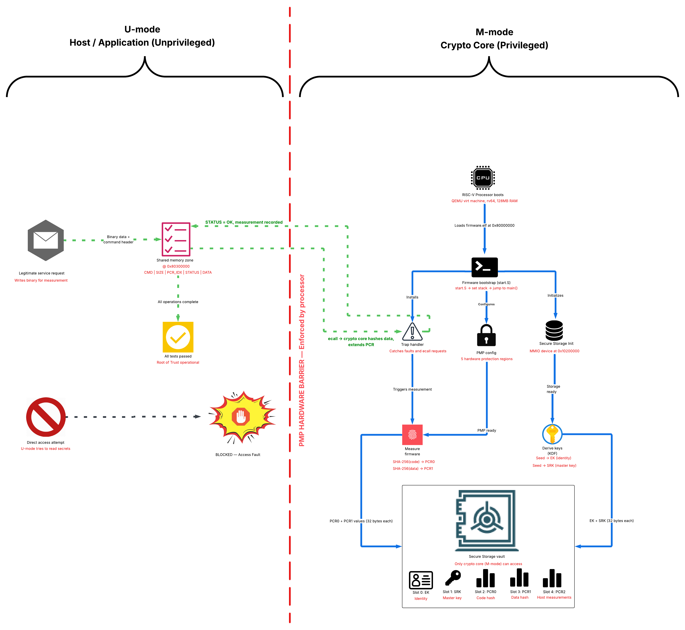

# Root of Trust Firmware for RISC-V

Bare-metal security firmware for RISC-V that implements TPM 2.0 functions using Physical Memory Protection (PMP) for hardware isolation. No OS, no stdlib, just firmware on the processor.

Built as a capstone project at Instituto Tecnologico de Costa Rica.

## Quick start

With Docker (easiest):

```bash
git clone https://gitlab.com/secce/riscv-rot.git && cd riscv-rot
docker build -t riscv-rot .
docker run --rm -it riscv-rot
```

Or build natively:

```bash
sudo apt install gcc-riscv64-linux-gnu

# build QEMU (one time, no submodules needed)
git clone --depth 1 https://gitlab.com/secce/qemu-ccore.git ~/qemu-ccore
cd ~/qemu-ccore && ./configure --target-list=riscv64-softmmu
cd build && ninja -j$(nproc) && cd ~

# build and run
git clone https://gitlab.com/secce/riscv-rot.git && cd riscv-rot
make && make run
```

If everything works you will see `ALL TESTS PASSED` at the end.

## What this is

A TPM is a security chip that stores keys, measures firmware, and lets a remote party verify that your system has not been tampered with. This project does the same thing in firmware using the protection mechanisms that RISC-V already has.

The crypto core runs in M-mode (highest privilege). It configures PMP to block all access to secrets from lower privilege modes. The only way for U-mode code to interact with the core is through a shared memory mailbox where it writes a command, triggers an ecall, and the core processes the request.

## Architecture



## What it can do

The firmware boots, measures its own code with SHA-256, derives identity keys (EK and SRK) using HMAC-SHA256, verifies integrity against golden values (Secure Boot), and then drops to U-mode where it accepts service requests.

Services available through the shared memory interface: integrity measurement of raw binaries into PCR registers, TPM2_Quote for remote attestation (signs all PCRs with the EK), sealed storage encrypted with AES-128 where the key is derived from the PCR state (if the firmware changes, the sealed data becomes unreadable), monotonic counters for anti-rollback protection, ELF header validation with a hash whitelist for measured launch, and supply chain attestation where each firmware component must be signed by a registered vendor.

Access control requires password authentication before any service. Three wrong passwords trigger a dictionary attack lockout. After authenticating, the host gets a session token that expires after 20 service calls, forcing re-authentication.

All crypto is standalone with no external dependencies: SHA-256 (FIPS 180-4), AES-128 (FIPS 197), and HMAC-SHA256 (RFC 2104).

## TPM 2.0 client library

The project includes a C library that follows TPM 2.0 command naming so anyone familiar with TPM programming can use it directly:

```c
#include "tpm2_api.h"

TPM2_Startup(password, password_len);
TPM2_PCR_Extend(2, firmware_binary, binary_size);

uint8_t sig[32];
TPM2_Quote(sig);

TPM2_Seal(secret, secret_len);
TPM2_Unseal(recovered, 32);

uint32_t counter;
TPM2_NV_Read(&counter);
TPM2_NV_Increment(expected_version, &new_value);

TPM2_ELF_Validate(elf_header);
TPM2_VerifySignature(vendor_id, signature, component, len);

TPM2_Shutdown();
```

All functions return `TPM2_RC_SUCCESS` on success or a specific error code.

## Python tools

`tools/verify_quote.py` verifies remote attestation by recomputing the Quote signature from the EK seed and comparing it with what the device reported. Run `python3 tools/verify_quote.py --demo` for a quick test.

`tools/rot_manager.py` parses QEMU output and shows a management dashboard with all PCRs, storage slots, counter values, and test results. It can also export a JSON report. Run `make run 2>&1 | tee output.txt`, kill QEMU, then `python3 tools/rot_manager.py --parse output.txt`.

## Project structure

| Path | What it does |
|------|-------------|
| `src/start.S` | Bootstrap: stack, BSS, jump to main |
| `src/main.c` | Boot sequence, measurement, Secure Boot check |
| `src/uart.c` | Serial output via MMIO |
| `src/pmp.c` | Configures 5 PMP regions |
| `src/trap.c` | Trap handler with auth, sessions, and all crypto services |
| `src/trap_entry.S` | Assembly trampoline for trap handling |
| `src/switch.c` | M-mode to U-mode transition |
| `src/user.c` | U-mode test suite (31 tests) |
| `src/secure_storage.c` | MMIO device driver |
| `src/pcr.c` | PCR extend operations |
| `src/keygen.c` | HMAC-SHA256 key derivation |
| `src/tpm2_api.c` | TPM 2.0 client library |
| `lib/sha256.c` | SHA-256 (FIPS 180-4) |
| `lib/aes128.c` | AES-128 (FIPS 197) |
| `tools/verify_quote.py` | Remote attestation verifier |
| `tools/rot_manager.py` | Management dashboard |
| `scripts/virt.ld` | Linker script |

## Memory map

| Address | What | U-mode |
|---------|------|--------|
| `0x10000000` | UART | Read + Write |
| `0x10200000` | Secure Storage MMIO | Blocked |
| `0x80000000` | Firmware code and data | Read + Write + Execute |
| `0x80100000` | Secret zone (4KB) | Blocked |
| `0x80300000` | Shared memory (4KB) | Read + Write, no execute |

## Secure storage slots

Slot 0 holds the Endorsement Key (32 bytes), slot 1 the Storage Root Key (32 bytes), slots 2-4 hold PCR snapshots, slot 5 is the monotonic counter (4 bytes), slot 6 holds sealed data encrypted with AES-128, and slot 7 stores the seal policy hash.

## Tests

The firmware runs 31 automated tests covering PMP isolation (read and write blocked), authentication (wrong password, lockout, correct password), session management (token creation, TTL exhaustion, expiry), monotonic counters (read, increment, rollback rejection), TPM2_Quote (signature consistency), sealed storage (seal, unseal, PCR mismatch rejection), real binary measurement (actual firmware code), ELF validation (valid RISC-V accepted, ARM rejected), whitelist verification (register and check), and supply chain attestation (valid signature, tampered rejection, unknown vendor rejection).

## QEMU device

We forked QEMU and added a Secure Storage MMIO device at 0x10200000 with 8 slots of 64 bytes each. The fork is at [gitlab.com/secce/qemu-ccore](https://gitlab.com/secce/qemu-ccore). No external submodules are needed to build it, just clone with `--depth 1` and run configure + ninja.

## References

TCG TPM 2.0 Library Specification v185, RISC-V Privileged Specification v1.12, NIST SP 800-108 (KDF), NIST SP 800-155 (BIOS Integrity Measurement), NIST SP 800-193 (Platform Firmware Resiliency), FIPS 180-4 (SHA-256), FIPS 197 (AES), Sailer et al. "Design and Implementation of a TCG-based IMA" USENIX Security 2004.

## Author

Sebastian Alba, Computer Engineering, Instituto Tecnologico de Costa Rica. Supervisor: Dr.-Ing. Jeferson Gonzalez Gomez, SECCE Research Group.
